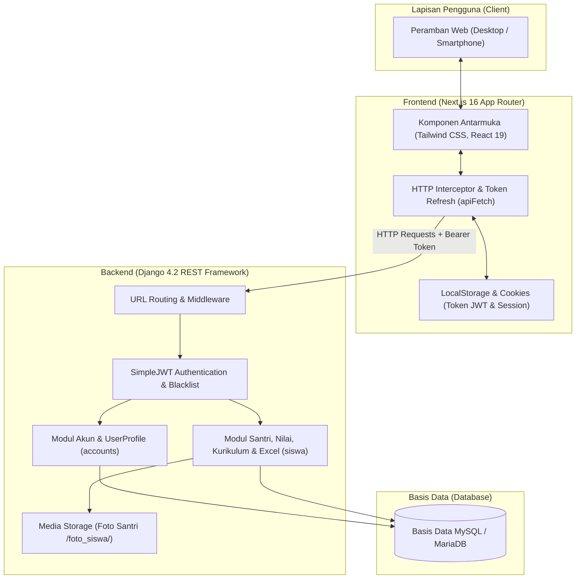
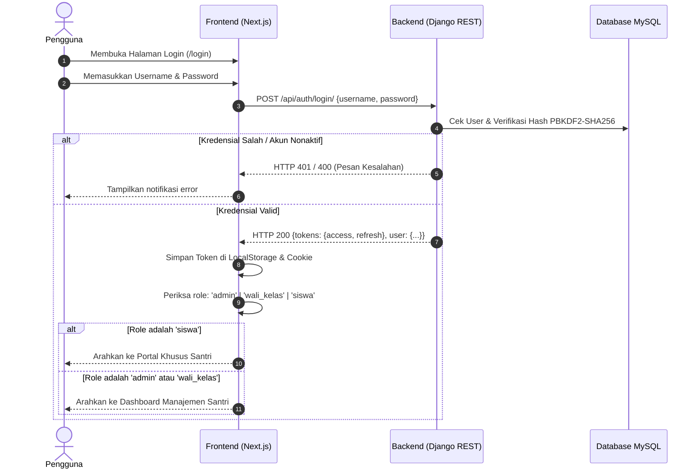
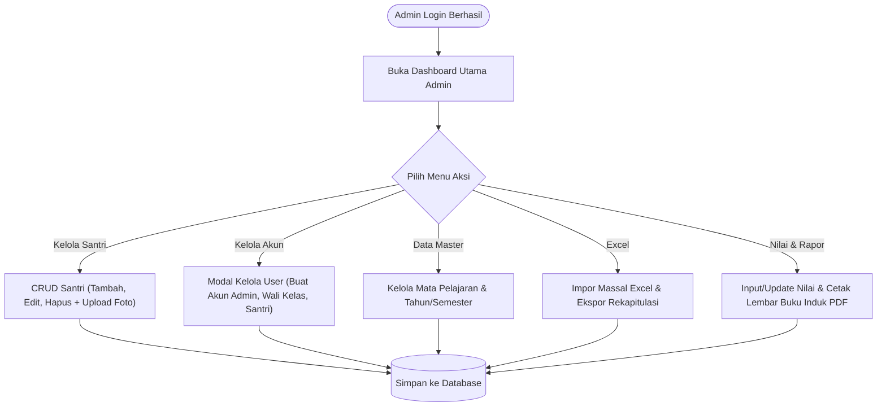
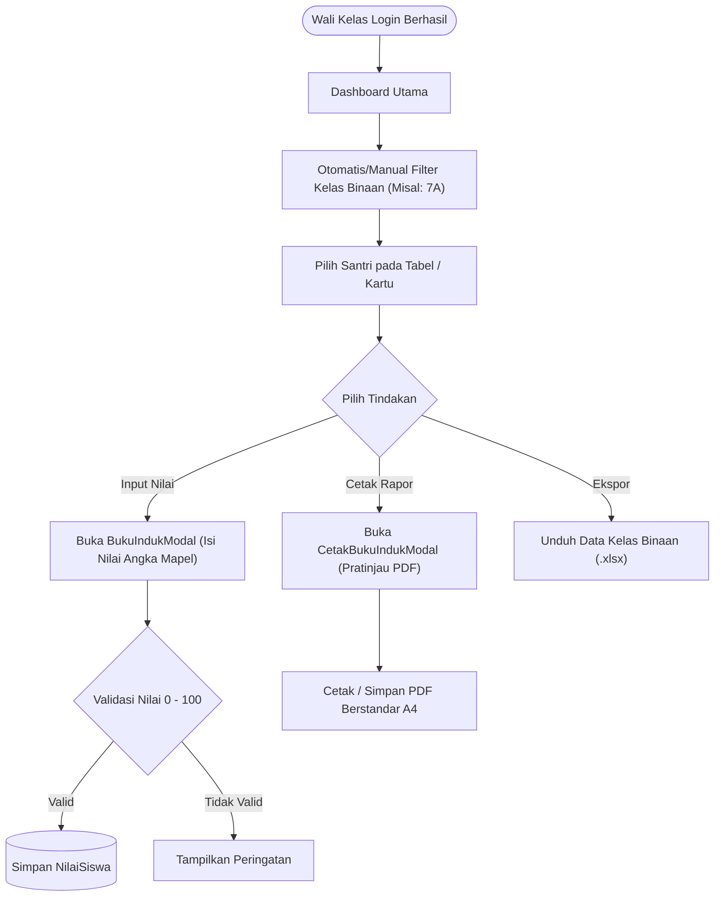
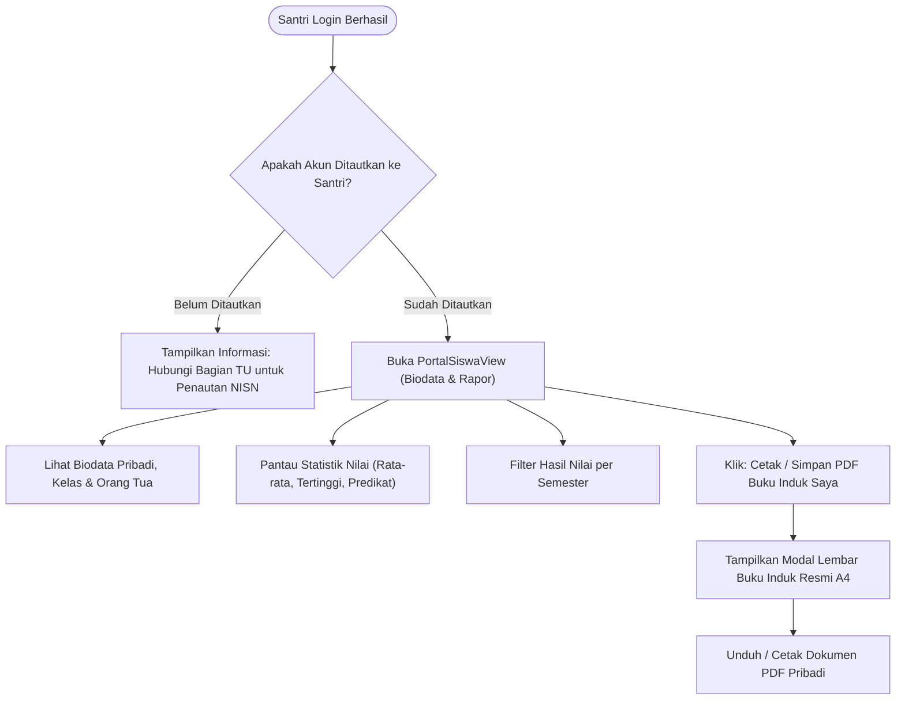
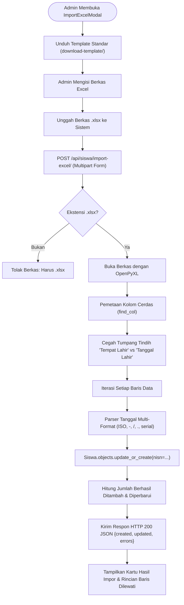
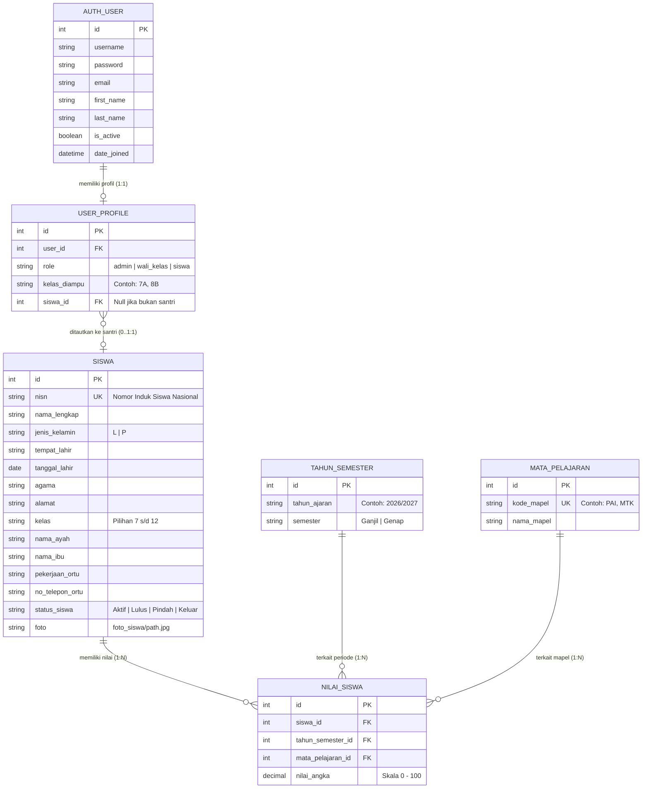

# Alur Program & Arsitektur Sistem
## Aplikasi Buku Induk Santri Pondok Pesantren Miftahul Huda Al-Faqih

Dokumen ini menjelaskan alur kerja (*workflow*), arsitektur sistem, skema data, dan mekanisme keamanan yang diterapkan pada **Aplikasi Buku Induk Santri Pondok Pesantren Miftahul Huda Al-Faqih** (di bawah naungan **Yayasan Al-Faqih**, Manonjaya, Kabupaten Tasikmalaya, Jawa Barat).

---

## Daftar Isi
1. [Arsitektur Global Monorepo](#1-arsitektur-global-monorepo)
2. [Alur Autentikasi & Kontrol Peran (RBAC)](#2-alur-autentikasi--kontrol-peran-rbac)
3. [Alur Kerja Berdasarkan Hak Akses Pengguna](#3-alur-kerja-berdasarkan-hak-akses-pengguna)
   - [3.1 Alur Kerja Admin / Tata Usaha (TU)](#31-alur-kerja-admin--tata-usaha-tu)
   - [3.2 Alur Kerja Wali Kelas](#32-alur-kerja-wali-kelas)
   - [3.3 Alur Kerja Santri / Siswa (Portal Mandiri)](#33-alur-kerja-santri--siswa-portal-mandiri)
4. [Alur Impor & Ekspor Berkas Excel (.xlsx)](#4-alur-impor--ekspor-berkas-excel-xlsx)
5. [Alur Evaluasi Nilai & Cetak Dokumen PDF Resmi](#5-alur-evaluasi-nilai--cetak-dokumen-pdf-resmi)
6. [Skema Relasi Database (ERD)](#6-skema-relasi-database-erd)
7. [Mekanisme Keamanan & Validasi Sistem](#7-mekanisme-keamanan--validasi-sistem)

---

## 1. Arsitektur Global Monorepo

Sistem dibangun menggunakan pendekatan monorepo yang memisahkan lapisan penyajian (*frontend*) dan lapisan pengolahan logika bisnis serta basis data (*backend*), yang berkomunikasi secara terenkripsi melalui protokol REST API.

---

## 2. Alur Autentikasi & Kontrol Peran (RBAC)

Setiap pengguna yang mengakses sistem harus melalui proses validasi kredensial. Sistem menggunakan token JWT (*Access Token* dengan durasi 60 menit dan *Refresh Token* 7 hari).

### Mekanisme *Auto-Refresh Token*
Jika *Access Token* kedaluwarsa saat pengguna sedang aktif, fungsi `apiFetch` pada frontend secara transparan mengirimkan *Refresh Token* ke endpoint `/api/auth/token/refresh/` untuk mendapatkan *Access Token* baru tanpa mengganggu sesi pengguna.

---

## 3. Alur Kerja Berdasarkan Hak Akses Pengguna

### 3.1 Alur Kerja Admin / Tata Usaha (TU)
Admin memiliki hak kontrol tertinggi atas seluruh siklus operasional data akademik dan kepegawaian.

**Kemampuan Khusus Admin:**
1. **Kelola Pengguna (`UserManagementModal`)**:
   - Menambah akun untuk Wali Kelas (disertai penugasan kelas yang diampu dari Kelas 7 s/d 12).
   - Menambah akun untuk Santri (menautkan akun langsung ke rekaman santri di basis data).
   - Melakukan reset password instan bagi pengguna yang lupa kata sandi.
   - Mengaktifkan atau menonaktifkan status akun pengguna.
2. **Kelola Data Master (`MasterDataModal`)**:
   - Menambah mata pelajaran baru beserta kodenya.
   - Menambah periode tahun ajaran baru dan semester (Ganjil/Genap).

---

### 3.2 Alur Kerja Wali Kelas
Wali Kelas berfokus pada evaluasi belajar, penginputan nilai, dan penerbitan lembar buku induk santri binaannya.

---

### 3.3 Alur Kerja Santri / Siswa (Portal Mandiri)
Santri mendapatkan antarmuka mandiri yang terisolasi total, memastikan kerahasiaan dan privasi data santri lain tetap terjaga.

> [!NOTE]
> Pada level backend (`SiswaViewSet` dan `NilaiSiswaViewSet`), jika pengguna memiliki peran `siswa`, query database dibatasi hanya untuk `id == request.user.profile.siswa_id`. Permintaan pengubahan (*POST/PUT/DELETE*) atau ekspor seluruh data akan langsung ditolak dengan kode `HTTP 403 Forbidden`.

---

## 4. Alur Impor & Ekspor Berkas Excel (.xlsx)

Fitur impor massal dirancang tahan terhadap variasi penamaan kolom dan variasi format tanggal Excel.

---

## 5. Alur Evaluasi Nilai & Cetak Dokumen PDF Resmi

Pencetakan lembar buku induk santri menggunakan format resmi cetak A4 dengan tata letak kedinasan.

```mermaid
flowchart LR
    PilihSantri[Pilih Santri] --> AmbilDetail["Ambil Data Santri & Nilai (/api/siswa/{id}/)"]
    AmbilDetail --> RenderKop["Render Kop Surat Resmi Yayasan Al-Faqih"]
    RenderKop --> RenderBio["Render Keterangan Diri Santri & Pas Foto 3x4"]
    RenderBio --> RenderNilai["Render Tabel Hasil Belajar & Rata-rata/Predikat"]
    RenderNilai --> RenderTtd["Render Kolom Pengesahan 3 Pihak"]
    RenderTtd --> WindowPrint["Trigger window.print()"]
    WindowPrint --> DokumenPDF[Hasil Lembar PDF / Cetak Fisik A4]
```

### Komponen Kop Surat Resmi:
1. **Logo Tunggal Sebelah Kiri**: Logo resmi Pondok Pesantren Miftahul Huda Al-Faqih (segi enam hijau).
2. **Identitas Yayasan**: `YAYASAN AL-FAQIH`.
3. **Identitas Lembaga**: `PONDOK PESANTREN MIFTAHUL HUDA AL-FAQIH`.
4. **Satuan Pendidikan**: `SEKOLAH MENENGAH ATAS ISLAM TERPADU AL-FAQIH (SMA IT AL-FAQIH)`.
5. **Legitimasi**: `TERAKREDITASI A` &bull; `NPSN: 69983922`.
6. **Alamat**: `Jl. Gunungtanjung Dusun Cisitu Kidul RT. 012 RW. 005 Desa Kalimanggis, Kec. Manonjaya (46197), Kab. Tasikmalaya`.
7. **Kontak**: `Telp. (0851 8776 1692) | Email: smaitalfaqih19@gmail.com`.
8. **Pengesahan Tiga Pihak**:
   - Orang Tua / Wali Santri
   - Wali Kelas
   - Kepala Sekolah / Pimpinan Lembaga (**Aldi Pratama Mustawan, S.Ag**)

---

## 6. Skema Relasi Database (ERD)

Diagram berikut menggambarkan entitas utama dalam basis data MySQL:

---

## 7. Mekanisme Keamanan & Validasi Sistem

1. **Enkripsi Sandi (*Password Hashing*)**:
   - Seluruh password dienkripsi secara satu arah (*one-way salted hash*) menggunakan algoritma **PBKDF2 dengan SHA-256** bawaan Django. Tidak ada password yang disimpan dalam bentuk teks biasa (*plain text*).
2. **Isolasi Queryset (*Data Segregation*)**:
   - Santri hanya dapat membaca baris data miliknya sendiri. Penolakan akses dilakukan langsung pada lapisan ORM backend (`get_queryset`), mencegah kebocoran data meskipun endpoint dimanipulasi melalui inspect tool/curl.
3. **Validasi File Unggahan**:
   - File Excel hanya menerima format biner `.xlsx`.
   - File foto santri divalidasi format gambarnya (*JPG/PNG/WEBP*) melalui pustaka Python Pillow sebelum disimpan ke folder media.
4. **Pencegahan Penghapusan Diri Sendiri (*Self-Deletion Safeguard*)**:
   - Admin yang sedang login diblokir secara sistem saat mencoba menghapus akun miliknya sendiri untuk mencegah hilangnya akses administratif ke sistem.

---

Dokumen ini disusun untuk memudahkan pemeliharaan, pengembangan fitur lanjutan, dan audit teknis pada **Aplikasi Buku Induk Santri Pondok Pesantren Miftahul Huda Al-Faqih**.
